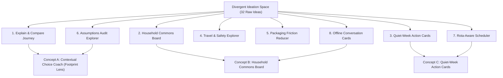
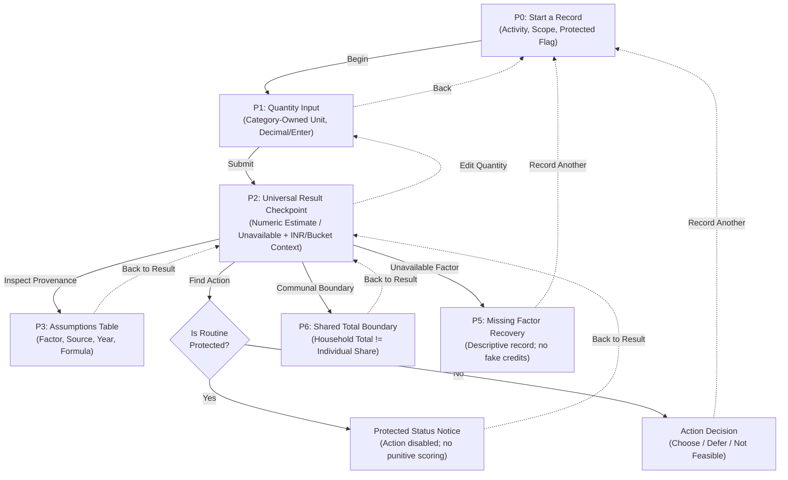
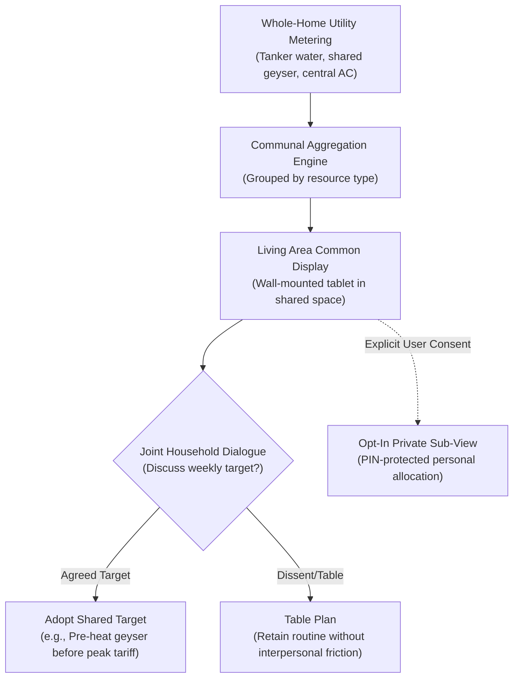
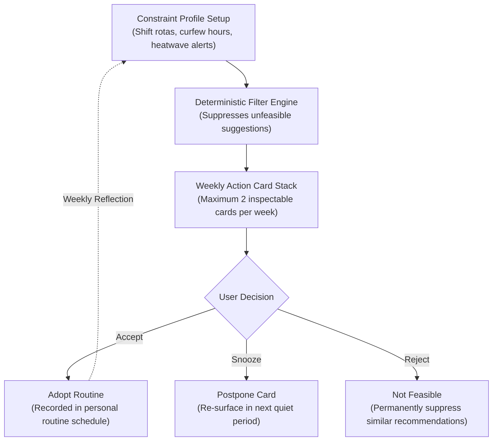

# D2 Concept Sketches, Interaction Diagrams and Selection Evidence

## 1. Divergent Ideation Canvas

To avoid premature fixation on a standard personal carbon dashboard, the team conducted a structured divergent ideation workshop utilizing *Crazy Eights* and *10-plus-10* sketching across the three target personas:
- **Persona 1 (Aanya):** University student in a shared PG/flat with unmetered utilities and split incentives.
- **Persona 2 (Rohan):** Young professional working nocturnal BPO/IT shifts with strict safety travel constraints.
- **Persona 3 (Meera):** Homemaker managing a multi-generational household budget, appliances, and water.

The 32 generated concepts were synthesized into **eight distinct response families**:



---

## 2. Three Distinct Conceptual Models

### Concept A — Contextual Choice Coach (Footprint Lens)
* **Interaction Paradigm:** Micro-decision checkpoint with contextual transparency.
* **Core Loop:** Routine Selection $\rightarrow$ Quantity Input $\rightarrow$ Universal Result Checkpoint $\rightarrow$ Branching (Assumptions, Constraint Action, Communal Boundary, or Missing Factor Recovery).



* **Distinctive Value:** Rather than viewing carbon footprinting as an accounting exercise, Concept A treats the calculation as a *trust checkpoint*. If a factor is illustrative, its provenance is transparently displayed; if a habit is driven by safety or shifts, it is protected from shaming; if a factor is unknown, it is descriptively preserved.

---

### Concept B — Household Commons Board
* **Interaction Paradigm:** Communal resource coordination and consensus dialogue.
* **Core Loop:** Whole-Home Utility Aggregation $\rightarrow$ Common Living Room Display $\rightarrow$ Joint Household Discussion $\rightarrow$ Consented Private View.



* **Distinctive Value:** Solves the multi-tenant split incentive (L1) and intergenerational friction (L2) by rejecting individual blame. It acknowledges that in Indian households, large energy loads (air conditioning, refrigerators, geysers) are communal.
* **Key Risk:** Building verified consent models and fair sub-metering algorithms is technically difficult for a small desktop MVP.

---

### Concept C — Quiet-Week Action Cards
* **Interaction Paradigm:** Asynchronous, low-friction constraint nudges.
* **Core Loop:** One-time Constraint Setup $\rightarrow$ Deterministic Filtering $\rightarrow$ Maximum 2 Cards / Week $\rightarrow$ Action Decision $\rightarrow$ Weekly Reflection.



* **Distinctive Value:** Minimizes user cognitive load (S3). Users do not have to perform daily logging; the system respects their attention and constraints.
* **Key Risk:** Without activity logging, users cannot visualize the concrete magnitude of their routines or verify calculation assumptions.

---

## 3. Multi-Criteria Decision Matrix (MCDM)

| Criterion | Weight | Concept A (Choice Coach) | Concept B (Commons Board) | Concept C (Quiet Cards) |
|---|:---:|:---:|:---:|:---:|
| **D1 Must Epic Coverage (E1--E5)** | 25% | **5.0/5.0:** Fully satisfies E1--E5 in a single walkthrough. | **3.0/5.0:** Weak on individual action (E3) and brief logging (E5). | **3.0/5.0:** Lacks assumption inspection (E2) and category breadth (E4). |
| **Stakeholder Fit (P1--P3)** | 25% | **4.5/5.0:** Fits flatshares (P1), shift workers (P2), and families (P3). | **4.0/5.0:** Strong for families, invasive for flatmates. | **3.5/5.0:** Strong for shift workers, limited for general tracking. |
| **Technical Feasibility** | 20% | **5.0/5.0:** Deterministic business logic; clean JavaFX MVP. | **2.5/5.0:** Requires complex multi-user sync and shared auth. | **3.5/5.0:** Requires notification daemon and scheduler state. |
| **Scientific Provenance** | 15% | **5.0/5.0:** Dedicated P3 assumptions table with factor transparency. | **3.0/5.0:** Aggregation obscures calculation formulas. | **2.5/5.0:** Recommendations detached from quantitative data. |
| **Risk Profile** | 15% | **4.5/5.0:** Low risk; false precision mitigated by disclaimers. | **2.0/5.0:** High privacy and interpersonal coercion risk. | **3.0/5.0:** Risk of perceived black-box advice. |
| **Weighted Total** | **100%** | **4.65 / 5.00 (Selected)** | **3.00 / 5.00** | **3.20 / 5.00** |

---

## 4. Competitor Differentiation Matrix

| Dimension | Earth Hero / Klima | UN Carbon Calculator | Capture / Giki Zero | Footprint Lens (Concept A) |
|---|---|---|---|---|
| **Emission Factor Transparency** | Hidden backend constants; single total. | National averages; hidden formula. | Proprietary algorithm; gamified score. | **Inspectable Provenance:** Full factor, source, year, and formula on P3. |
| **Constraint / Safety Protection** | Flat penalty; lectures users on car use. | Static questionnaire; ignores shift rotas. | Badges penalize necessary travel. | **Protected Flag:** Safety, night shifts, and heat disable punitive advice. |
| **Communal Scope Integrity** | Divides utility bills equally by residents. | Linear division by household count. | Assumes individual owns all bills. | **Communal Boundary:** Household totals never attributed to one resident. |
| **Circular / Indigenous Habits** | Fabricates carbon credits or ignores repair. | Only tracks flights, cars, and diet. | Requires bank transaction sync. | **Descriptive Logging:** Circular repair/reuse logged without fake credits. |
| **Algorithmic Transparency** | Proprietary behavioral AI nudges. | Static tips. | Black-box behavioral scoring. | **Deterministic Engine:** 100% open, auditable, non-speculative rules. |

---

## 5. Low-Fidelity Wireframe Specification (Balsamiq / Figma Architecture)

To strictly adhere to the COMP2300 D2 brief (*"You are not expected to do any programming, and you will lose marks if the fidelity of your prototype is inappropriate... it should not have obvious conceptual or usability problems"*), the prototype is specified and documented as a **Low-Fidelity Wireframe Suite**.

### Layout Blueprint & Architectural Shell
Each screen follows a standardized wireframe shell containing:
1. **Header Bar:** Project Title, Subtitle, and clear disclaimer badge: `[ Low-Fidelity Wireframe -- Illustrative Design Only ]`.
2. **Left-Hand Journey Rail (States P0--P6):** Explicit breadcrumbs showing where the user is in the micro-decision loop, plus a non-destructive `[ Reset Prototype ]` escape hatch.
3. **Main Content Card (800px):** Form controls, read-only category-owned units, contextual comparisons, and dual-action buttons.

```
+--------------------------------------------------------------------------------------------------+
| FOOTPRINT LENS  [ Low-Fidelity Prototype -- Concept A ]               [ Illustrative Design Only ]|
| An India-centric lens for understanding routines, checking assumptions and choosing actions.     |
+---------------------------------+----------------------------------------------------------------+
| JOURNEY ROUTE                   | PANEL WORKSPACE                                                |
| [*] P0: Start a record          |                                                                |
| [ ] P1: Describe quantity       |  (Panel Content Rendered Here)                                 |
| [ ] P2: See result              |                                                                |
| [ ] P3: Assumptions             |                                                                |
| [ ] P4: Realistic action        |                                                                |
| [ ] P5: Unknown estimate        |                                                                |
| [ ] P6: Shared total            |                                                                |
|                                 |                                                                |
| [ Reset Prototype ]             |                                                                |
+---------------------------------+----------------------------------------------------------------+
```

---

### Detailed Wireframe Cards (P0 through P6)

#### Panel P0: Start a Record (Activity Selection & Scope Boundary)
```
+--------------------------------------------------------------------------------------------------+
| P0 · START A RECORD                                                                              |
| What would you like to understand?                                                               |
| Scope remains explicit so shared totals are not mistaken for personal footprints.                |
|                                                                                                  |
|   Activity Category:  [ Home electricity                      |v]                                |
|   Scope Boundary:     [ Me / my activity                      |v]                                |
|                                                                                                  |
|   [ ] Mark as protected or necessary (Shift rota, safety, medical, heatwave constraint)          |
|                                                                                                  |
|   [ Continue to quantity > ]     [ Load illustrative example ]     [ Preview shared boundary ]   |
+--------------------------------------------------------------------------------------------------+
```
* **Accessibility & Usability:** `<label for>` bindings, explicit visual scope distinction (Aanya/Rohan personas), safety bypass flag preventing punitive scoring.

#### Panel P1: Describe It (Quantity Input & Unit Ownership)
```
+--------------------------------------------------------------------------------------------------+
| P1 · DESCRIBE QUANTITY                                                                           |
| How much would you like to record?                                                               |
| Category: Home electricity | Scope: Personal (Me)                                                |
|                                                                                                  |
|   Amount:         [ 168.0                     ]   (Numeric input, Enter to submit)               |
|   Unit of Record: [ kWh (Kilowatt-hours)      ]   <-- Read-only category-owned unit              |
|                                                                                                  |
|   ( ! ) Error notice appears here if empty or negative                                           |
|                                                                                                  |
|   [ See estimated result > ]     [ < Back to category ]                                          |
+--------------------------------------------------------------------------------------------------+
```
* **Accessibility & Usability:** Unit is owned by the category to prevent dimensional mismatch; non-destructive back button; decimal validation with inline live announcement.

#### Panel P2: See the Result (Universal Router & Contextual Equivalence)
```
+--------------------------------------------------------------------------------------------------+
| P2 · RESULT CHECKPOINT                                                                           |
| Estimated Carbon Footprint:                                                                      |
|                                                                                                  |
|   ====== 120.288 kg CO2 ======                                                                   |
|   Contextual Reference: Equivalent to INR 1,344.00 electricity bill (Slab 2)                      |
|                                                                                                  |
|   [ Inspect assumptions (P3) ]     [ Choose realistic action (P4) ]                              |
|   [ Review shared boundary (P6) ]  [ Edit quantity (P1) ]                                        |
+--------------------------------------------------------------------------------------------------+
```
* **Accessibility & Usability:** Solves abstract "kg CO2" comprehension barrier through familiar economic context (INR) or volume context (15L water buckets); acts as a 4-way universal router.

#### Panel P3: Inspect Assumptions (Scientific Provenance Table)
```
+--------------------------------------------------------------------------------------------------+
| P3 · DATA PROVENANCE & ASSUMPTIONS                                                               |
| Complete audit trail for the calculation:                                                        |
|                                                                                                  |
|   Metric                  | Value / Source                                                       |
|   ------------------------+-------------------------------------------------------------------   |
|   Activity Name           | Home electricity                                                     |
|   Input Quantity          | 168.0 kWh                                                            |
|   Stored Scope            | Personal (Me)                                                        |
|   Emission Factor         | 0.716 kg CO2/kWh                                                     |
|   Factor Source           | CEA CO2 Baseline Database for Indian Power Sector (D1 fixture)       |
|   Geographic Scope        | National Grid Average (India)                                        |
|   Calculation Formula     | 168.0 kWh * 0.716 kg CO2/kWh = 120.288 kg CO2                        |
|                                                                                                  |
|   [ < Back to result ]     [ Record another routine ]                                            |
+--------------------------------------------------------------------------------------------------+
```
* **Accessibility & Usability:** Full semantic `<table>` with headers; proves open-box deterministic methodology; addresses Epic E2 without speculative algorithms.

#### Panel P4: Choose an Action (Constraint-Aware Decision State)
```
+--------------------------------------------------------------------------------------------------+
| P4 · REALISTIC ACTION DECISION                                                                   |
| Target Routine: Night auto-rickshaw travel (15 km) | Status: [ PROTECTED: Night Shift Safety ]   |
|                                                                                                  |
|   +------------------------------------------------------------------------------------------+   |
|   | (i) ACTION DECISIONS ARE DISABLED:                                                       |   |
|   | This activity is marked as protected or necessary. The system will not lecture or        |   |
|   | suggest unsafe substitution (e.g. night public transit). Your safety comes first.        |   |
|   +------------------------------------------------------------------------------------------+   |
|                                                                                                  |
|   [ Choose Action (Disabled) ]   [ Defer Action (Disabled) ]   [ < Back to result ]              |
+--------------------------------------------------------------------------------------------------+
```
* **Accessibility & Usability:** Directly honors Rohan's persona; disables punitive nudges; prevents moralizing advice when constraints exist. When not protected, offers non-preachy choices.

#### Panel P5: Unknown Estimate (Missing Factor Graceful Degradation)
```
+--------------------------------------------------------------------------------------------------+
| P5 · ESTIMATE UNAVAILABLE                                                                        |
| Category: Delivery packaging / Circular repair                                                   |
|                                                                                                  |
|   +------------------------------------------------------------------------------------------+   |
|   | We do not have a verified, defensible conversion factor for this category.               |   |
|   | Rather than fabricating an artificial carbon estimate or selling dubious offsets,        |   |
|   | Footprint Lens records your descriptive entry truthfully.                                |   |
|   +------------------------------------------------------------------------------------------+   |
|                                                                                                  |
|   [ Record another routine ]     [ < Back to category ]                                          |
+--------------------------------------------------------------------------------------------------+
```
* **Accessibility & Usability:** Rejects fake precision; transparently respects scientific boundaries; supports circular economy habits without gamified penalties.

#### Panel P6: Shared Total Boundary (Communal Protection)
```
+--------------------------------------------------------------------------------------------------+
| P6 · SHARED BOUNDARY EXPLORER                                                                    |
| Household Commons vs Personal Allocation                                                         |
|                                                                                                  |
|      ( Household Total: 168 kWh )  =/=  ( Individual Share: Undivided )                          |
|                                                                                                  |
|   A communal meter measures total household consumption. Attributing this equally or             |
|   penalizing one resident ignores shared appliances (geysers, refrigerators, air conditioning).   |
|                                                                                                  |
|   [ < Back to result ]     [ Record another routine ]                                            |
+--------------------------------------------------------------------------------------------------+
```
* **Accessibility & Usability:** Addresses Aanya's flatmate tension; prevents false individual guilt in shared domestic environments.

---

## 6. Synthesis: Bridging Low-Fi Wireframes and Technical Feasibility

| Dimension | Coursework Requirement | Group Realization & Artifact |
|---|---|---|
| **Visual Fidelity** | Must be low-fidelity (no premature graphic polish) | Grayscale Balsamiq/Figma wireframe layouts documented above and rendered in LaTeX TikZ figures. |
| **Tooling & Media** | Paper, Balsamiq, Moqups, Figma, etc. | Divergent paper sketches for Concepts A/B/C + structured wireframe boards for Panels P0--P6. |
| **No Programming Expectation** | Students are not required to code | Code is strictly a lightweight structural simulation of state transitions ($P0 \to P6$) and accessibility. |
| **Novelty & Feasibility** | Feasible now, no speculative ML, more than a log | Deterministic rules engine, contextual equivalence (INR/Buckets), and protected constraint logic. |
| **Submission Vehicle** | Single PDF Report | All wireframes, ideation funnels, and user stories embedded directly in the compiled PDF deliverable. |

