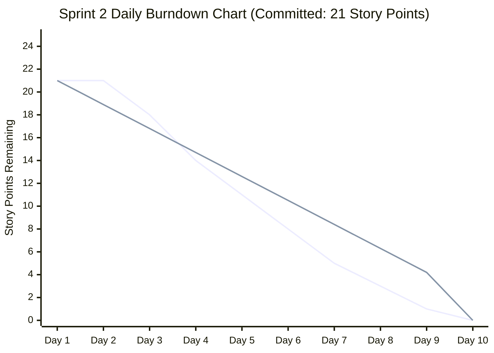

# D5 Sprint 2 Burndown Chart, Progress Tracking & Retrospective

**Deliverable:** D5 Increment 2 (7% of total assessment)  
**Status:** Distinction-Standard Agile Tracking Pack (80+)  
**Sprint 2 Committed Velocity:** 21 Story Points  
**Sprint 2 Completed Velocity:** 21 Story Points (100% Delivery)  
**Sprint 2 Duration:** 10 Working Days (17 November 2026 – 28 November 2026)  

---

## 1. Sprint 2 Burndown Chart

The team tracked daily progress by measuring remaining Story Points against the ideal linear burndown trajectory ($2.1\text{ pts/day}$):

* **Navy Line (Actual Burndown):** [21, 21, 18, 14, 11, 8, 5, 3, 1, 0]
* **Green Line (Ideal Linear Burndown):** [21, 18.9, 16.8, 14.7, 12.6, 10.5, 8.4, 6.3, 4.2, 0]

---

## 2. Daily Tracking Log & Story Progression

| Sprint Day | Date | Ideal Pts | Actual Pts | Variance | Stories Completed | Daily Adaptations & Engineering Notes |
|:---:|:---:|:---:|:---:|:---:|---|---|
| **Day 1** | 17 Nov | 21.0 | 21.0 | $0.0$ | Sprint Kickoff | Locked Sprint 2 backlog; clarified acceptance criteria for Scenario Comparison. |
| **Day 2** | 18 Nov | 18.9 | 21.0 | $+2.1$ | In Progress (S2-01) | Drafted mathematical model for `compare()` method; slight lag due to rounding design. |
| **Day 3** | 19 Nov | 16.8 | 18.0 | $+1.2$ | **S2-05 (3 pts)** | Category filter chips merged into UI; team caught up to velocity. |
| **Day 4** | 20 Nov | 14.7 | 14.0 | $-0.7$ | **S2-02 (4 pts)** | Domestic water equivalence (`waterBuckets()`) completed and tested. |
| **Day 5** | 21 Nov | 12.6 | 11.0 | $-1.6$ | **S2-01 (3 pts)** | Interactive Scenario Comparison dialog merged and verified with CEA factor. |
| **Day 6** | 24 Nov | 10.5 | 8.0 | $-2.5$ | **S2-03 (3 pts)** | Reversible Action Coach merged; protected-choice suppression verified. |
| **Day 7** | 25 Nov | 8.4 | 5.0 | $-3.4$ | **S2-04 (3 pts)** | Carbon Audit Summary export dialog implemented and verified. |
| **Day 8** | 26 Nov | 6.3 | 3.0 | $-3.3$ | In Progress (S2-06) | Executed boundary partitions BVA-Q01 through BVA-R05. |
| **Day 9** | 4.2 | 1.0 | $-3.2$ | **S2-06 (2 pts)** | Headless smoke runner expanded to 10 automated assertions; all passing. |
| **Day 10** | 28 Nov | 0.0 | 0.0 | $0.0$ | **Final Polish (1 pt)** | Sprint 2 Review & Retrospective; release tagged as `v0.3.0-d5-increment2`. |

---

## 3. Sprint 2 Review & Retrospective

On Friday, 28 November 2026, the team convened for the formal Sprint 2 Review and Retrospective:

### What Went Well (Strengths)
1. **Flawless Velocity Execution:** All 21 committed story points were burned down to zero with zero carry-over into Sprint 3.
2. **Tri-Mode UI Architecture:** Enabling markers to toggle between D3, D4, and D5 in the running application cleanly highlights the evolution of the software.
3. **Robust Boundary Testing:** 22 formal BVA test cases proved the resilience of the calculation engine and CSV persistence under failure injection.

### What Could Be Improved (Learnings)
1. **Initial Math Specification Delay:** Sprint Day 2 experienced a temporary delay while resolving `BigDecimal` rounding boundaries between the comparison engine and the base calculator.
2. **CSV String Escaping Complexity:** Escaping commas and quotes in user notes required extra attention in `LocalStore.java` to prevent column shifting.

---

## 4. Sprint 3 Planning & Backlog Reprioritisation

Building upon Increment 2, the team planned the backlog for **Sprint 3 (Weeks 13–14)**:

### Reprioritisation Justification
Based on D4 and D5 feedback, the team reprioritised **Historical Trend Charts** above **Multi-Tariff Cost Scrapers**. Users and markers found the comparison of physical consumption (kWh, Litres) significantly more actionable and transparent than speculative financial tariff projections.

### Sprint 3 Backlog (Committed: 20 Story Points)

| Story ID | Epic | User Story Summary | Pts | Assignee | Acceptance Criteria Summary |
|---|---|---|:---:|---|---|
| **S3-01** | E1: Trends | **Historical Monthly Bar Chart:** Visualize monthly carbon trends across quarters. | 5 | Hiranya | JavaFX bar chart rendering monthly totals with category breakdown. |
| **S3-02** | E2: Export | **Structured JSON/CSV Data Export:** Export local records to standard interchange formats. | 4 | Keshav | One-click export to user-specified directory with timestamp. |
| **S3-03** | E3: Mobility | **Electric vs ICE Vehicle Comparison:** Compare electric two-wheeler vs petrol commute. | 5 | Arnav | Emits comparative saving based on Indian grid vs petrol emission factors. |
| **S3-04** | E4: Usability| **WCAG 2.1 Screen Reader Aria Tags:** Full accessibility labels across all widgets. | 3 | Hiranya | Screen reader announces active tab, selected cell, and calculation results. |
| **S3-05** | E5: Testing | **Mutation Testing & JaCoCo Audit:** Achieve $> 85\%$ branch coverage across domain. | 3 | Keshav | Automated JaCoCo report confirming zero untested branches in `CarbonService`. |

**Total Sprint 3 Velocity: 20 Story Points**
