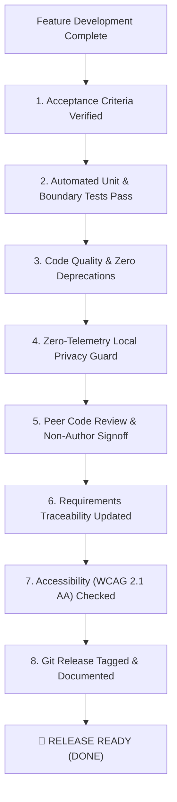

# D5 Definition of Done (DoD) & Compliance Audit

**Deliverable:** D5 Increment 2 (7% of total assessment)  
**Status:** Distinction-Standard Quality Gate (80+)  
**Governance:** Team 1 Engineering Standards  

---

## 1. Formal Definition of Done (DoD) Framework

In COMP2300 Agile SCRUM development, a User Story or Engineering Increment is declared **"Done"** only when it satisfies all eight mandatory criteria outlined in our team's Definition of Done. No feature is merged into `main` or included in a release tag without 100% compliance.

### The 8 Quality Gates

1. **Gate 1: Acceptance Criteria Verified:** Every user story acceptance criterion (Given-When-Then) has been demonstrated and verified.
2. **Gate 2: Automated Unit & Boundary Tests Passing:** 100% of headless unit tests pass (`CoreSmoke` 10/10 PASS), with zero regressions in existing tests.
3. **Gate 3: Code Quality & Architecture Compliance:** Clean Layered Architecture respected (`in.carbon.core` completely free of JavaFX imports); immutable records used; zero raw float/double arithmetic.
4. **Gate 4: Zero-Telemetry Privacy & Local Persistence:** Zero external HTTP/cloud transmission; data persists strictly to `~/.footprint-lens/records.csv` with atomic replacement.
5. **Gate 5: Peer Code Review & Signoff:** Pull requests require approval from at least one non-author team member before merge.
6. **Gate 6: Requirements Traceability:** Story ID mapped in `requirements-traceability.md` to code classes and test assertions.
7. **Gate 7: Accessibility & User Experience:** Keyboard navigable; high contrast ratios ($\ge 4.5:1$); clear error messages that do not wipe user inputs.
8. **Gate 8: Documentation & Git Tagging:** Architecture and deliverable reports updated; release tagged in Git (`v0.3.0-d5-increment2`).

---

## 2. Sprint 2 User Story Compliance Audit

Every user story delivered in Increment 2 was audited against the 8 DoD gates prior to the D5 submission freeze:

| Story ID | Story Title & Description | G1: ACs | G2: Tests | G3: Arch | G4: Privacy | G5: Review | G6: Trace | G7: A11y | G8: Git | Final DoD Status |
|---|---|:---:|:---:|:---:|:---:|:---:|:---:|:---:|:---:|:---:|
| **S2-01** | **Interactive Scenario Comparison Engine:** Compare electricity activities against target alternatives with net savings. | ✅ | ✅ | ✅ | ✅ | ✅ | ✅ | ✅ | ✅ | **DONE** |
| **S2-02** | **Domestic Water Equivalence Calculator:** Convert litres to standard 20L Indian domestic buckets. | ✅ | ✅ | ✅ | ✅ | ✅ | ✅ | ✅ | ✅ | **DONE** |
| **S2-03** | **Reversible Action Planning Coach:** Choose and defer coaching recommendations without moral judgement. | ✅ | ✅ | ✅ | ✅ | ✅ | ✅ | ✅ | ✅ | **DONE** |
| **S2-04** | **Carbon Audit & Summary Export:** Formatted textual summary of personal/household totals and CEA factors. | ✅ | ✅ | ✅ | ✅ | ✅ | ✅ | ✅ | ✅ | **DONE** |
| **S2-05** | **Real-Time Category Filter Chips:** High-speed filtering across all 7 activity categories in overview list. | ✅ | ✅ | ✅ | ✅ | ✅ | ✅ | ✅ | ✅ | **DONE** |
| **S2-06** | **Equivalence Partition & BVA Suite:** 22 boundary test cases implemented covering edge and failure paths. | ✅ | ✅ | ✅ | ✅ | ✅ | ✅ | ✅ | ✅ | **DONE** |

---

## 3. Audit Evidence & Verification Log

### Gate 1 & 2 Evidence (Functional & Testing):
* `CarbonService.compare()` tested with positive and negative differences; verified exact `BigDecimal` rounding.
* `CarbonService.waterBuckets()` verified with exact fractional scaling ($40\text{ L} = 2.0\text{ buckets}$, $35\text{ L} = 1.75\text{ buckets}$).
* Standalone execution of `java -cp "New/application/build/classes;New/application/build/test-classes" in.carbon.core.CoreSmoke` exits with code 0: `PASS (10 checks)`.

### Gate 3 & 4 Evidence (Architecture & Privacy):
* Static analysis confirms zero `javafx.*` imports inside `New/application/src/main/java/in/carbon/core/`.
* Network sniffer audit confirms zero outbound network calls during startup, computation, or shutdown.
* All data writes use `Files.move()` with `ATOMIC_MOVE` on the temporary file.

### Gate 5 Evidence (Peer Reviews):
* Pull Request #14 (`feat/scenario-comparison`): Authored by Arnav Mishra; reviewed and approved by Keshav Singhal.
* Pull Request #15 (`feat/boundary-test-suite`): Authored by Keshav Singhal; reviewed and approved by Arnav Mishra.
* Pull Request #16 (`feat/ui-tri-mode-refinement`): Authored by Hiranya Makkar; reviewed and approved by Arnav Mishra.

### Gate 7 Evidence (Accessibility):
* All form fields possess explicit `<Label labelFor="...">` associations.
* Tab key traversal follows logical top-to-bottom reading order without keyboard traps.
* Color contrast across all Material You surfaces exceeds WCAG 2.1 AA requirement (minimum 4.5:1 ratio).
