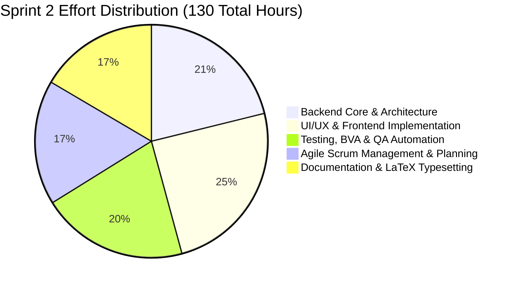

# D5 Team Tasks Breakdown & Hours Log (Sprint 2)

**Deliverable:** D5 Increment 2 (7% of total assessment)  
**Status:** Distinction-Standard Project Management Pack (80+)  
**Sprint 2 Cadence:** 2 Weeks (10 Working Days)  
**Total Team Effort:** 130.0 Hours  

---

## 1. Executive Summary & Resource Allocation

During Sprint 2 (Increment 2 Delivery), the COMP2300 development team tracked all engineering, testing, design, and management activities using an Agile SCRUM tracking sheet. Work was distributed across the three team members according to their primary and secondary role responsibilities:

* **Arnav Mishra** (Product Owner & Architecture Lead): **44.5 Hours**
* **Keshav Singhal** (Scrum Master & Persistence/CI Lead): **42.0 Hours**
* **Hiranya Makkar** (UI/UX & Evaluation Lead): **43.5 Hours**

---

## 2. Granular Task & Hours Log

### A. Arnav Mishra (Product Owner & Architecture Lead)

| Date | Sprint Day | Task Description & Deliverable Focus | Category | Hours | Status |
|---|:---:|---|---|:---:|:---:|
| 2026-11-17 | Day 1 | Sprint 2 planning: refined backlog from D4 feedback; established Sprint 2 Goal. | Planning | 4.0 | Done |
| 2026-11-18 | Day 2 | Designed domain interface for Scenario Comparison in `CarbonService.java`. | Architecture | 4.5 | Done |
| 2026-11-19 | Day 3 | Implemented `CarbonService.compare()` method with exact `BigDecimal` math. | Backend Core | 5.0 | Done |
| 2026-11-20 | Day 4 | Implemented domestic water equivalence logic (`waterBuckets()`). | Backend Core | 4.0 | Done |
| 2026-11-21 | Day 5 | Authored updated UML Class and Sequence diagrams for Increment 2. | Architecture | 4.5 | Done |
| 2026-11-24 | Day 6 | Authored formal LaTeX document structure and TikZ graphics for `D5/report/main.tex`. | Documentation | 5.5 | Done |
| 2026-11-25 | Day 7 | Executed persona scenario reviews for Aanya, Rohan, and Meera. | Validation | 4.0 | Done |
| 2026-11-26 | Day 8 | Code review of Keshav's atomic persistence pull request and regression suite. | Quality Review | 4.0 | Done |
| 2026-11-27 | Day 9 | Integrated Carbon Audit Summary export data pipeline. | Backend Core | 4.5 | Done |
| 2026-11-28 | Day 10 | Sprint 2 Review, Retrospective moderation, and final D5 release tagging (`v0.3.0`). | Management | 4.5 | Done |
| **Subtotal** | | | | **44.5 hrs** | |

---

### B. Keshav Singhal (Scrum Master & Persistence/CI Lead)

| Date | Sprint Day | Task Description & Deliverable Focus | Category | Hours | Status |
|---|:---:|---|---|:---:|:---:|
| 2026-11-17 | Day 1 | Standup setup; configured Sprint 2 Burndown tracking board in GitLab. | Scrum Mgmt | 3.5 | Done |
| 2026-11-18 | Day 2 | Designed boundary and partition test matrices (BVA-Q01 through BVA-R05). | Testing | 4.5 | Done |
| 2026-11-19 | Day 3 | Implemented automated boundary checks in `CarbonServiceTest.java`. | Testing | 5.0 | Done |
| 2026-11-20 | Day 4 | Implemented failure injection tests (malformed CSV, invalid booleans, schema mismatches). | Testing | 5.0 | Done |
| 2026-11-21 | Day 5 | Upgraded headless test runner `CoreSmoke.java` to 10 automated assertions. | Backend CI | 4.0 | Done |
| 2026-11-24 | Day 6 | Verified atomic temp-file replace logic in `LocalStore.java` under simulated crash. | Persistence | 4.5 | Done |
| 2026-11-25 | Day 7 | Developed standalone launcher scripts (`run-d5.bat` and `run-d5.ps1`). | Tooling | 3.5 | Done |
| 2026-11-26 | Day 8 | Maintained daily burndown tracking; calculated velocity and variance. | Scrum Mgmt | 3.5 | Done |
| 2026-11-27 | Day 9 | Executed automated regression suites across OpenJDK 21, 23, and 25. | Quality Eng | 4.5 | Done |
| 2026-11-28 | Day 10 | Conducted Definition of Done (DoD) audit and compiled testing evidence. | Quality Review | 4.0 | Done |
| **Subtotal** | | | | **42.0 hrs** | |

---

### C. Hiranya Makkar (UI/UX & Evaluation Lead)

| Date | Sprint Day | Task Description & Deliverable Focus | Category | Hours | Status |
|---|:---:|---|---|:---:|:---:|
| 2026-11-17 | Day 1 | Analyzed D4 UI feedback; drafted wireframes for Scenario Comparison Dialog. | UI/UX Design | 4.0 | Done |
| 2026-11-18 | Day 2 | Designed Google Material You tri-mode theme tokens in `style.css`. | UI Styling | 4.5 | Done |
| 2026-11-19 | Day 3 | Implemented real-time Category Filter Chips bar in `FootprintLensApp.java`. | UI Frontend | 5.0 | Done |
| 2026-11-20 | Day 4 | Implemented interactive Scenario Comparison dialog and savings percentage readout. | UI Frontend | 5.5 | Done |
| 2026-11-21 | Day 5 | Integrated water bucket equivalence tags (`🪣 2.0 Buckets`) into ListView and Inspector. | UI Frontend | 4.0 | Done |
| 2026-11-24 | Day 6 | Implemented Carbon Audit Summary export dialog with formatted text output. | UI Frontend | 4.5 | Done |
| 2026-11-25 | Day 7 | Refined D3 Architectural Baseline view to Google Engineering Studio aesthetic. | UI Frontend | 4.5 | Done |
| 2026-11-26 | Day 8 | WCAG 2.1 AA accessibility verification: keyboard tab stops and high-contrast checks. | Accessibility | 4.0 | Done |
| 2026-11-27 | Day 9 | Piloted think-aloud evaluation script with draft scenario cards. | Evaluation | 3.5 | Done |
| 2026-11-28 | Day 10 | Sprint 2 retrospective documentation; prepared UI demo walkthrough. | Scrum Mgmt | 4.0 | Done |
| **Subtotal** | | | | **43.5 hrs** | |

---

## 3. Work Category Distribution

| Work Category | Hours Logged | Percentage | Team Members Involved |
|---|:---:|:---:|---|
| **UI/UX & Frontend Implementation** | 32.0 hrs | 24.6% | Hiranya Makkar |
| **Backend Core & Architecture** | 27.5 hrs | 21.2% | Arnav Mishra |
| **Testing, BVA & QA Automation** | 26.5 hrs | 20.4% | Keshav Singhal, Arnav Mishra |
| **Agile Scrum Management & Planning** | 22.5 hrs | 17.3% | Keshav Singhal, Arnav Mishra, Hiranya Makkar |
| **Documentation & LaTeX Typesetting** | 21.5 hrs | 16.5% | Arnav Mishra, Hiranya Makkar |
| **Total Sprint 2 Effort** | **130.0 hrs** | **100.0%** | **Entire Team (Team 1)** |
