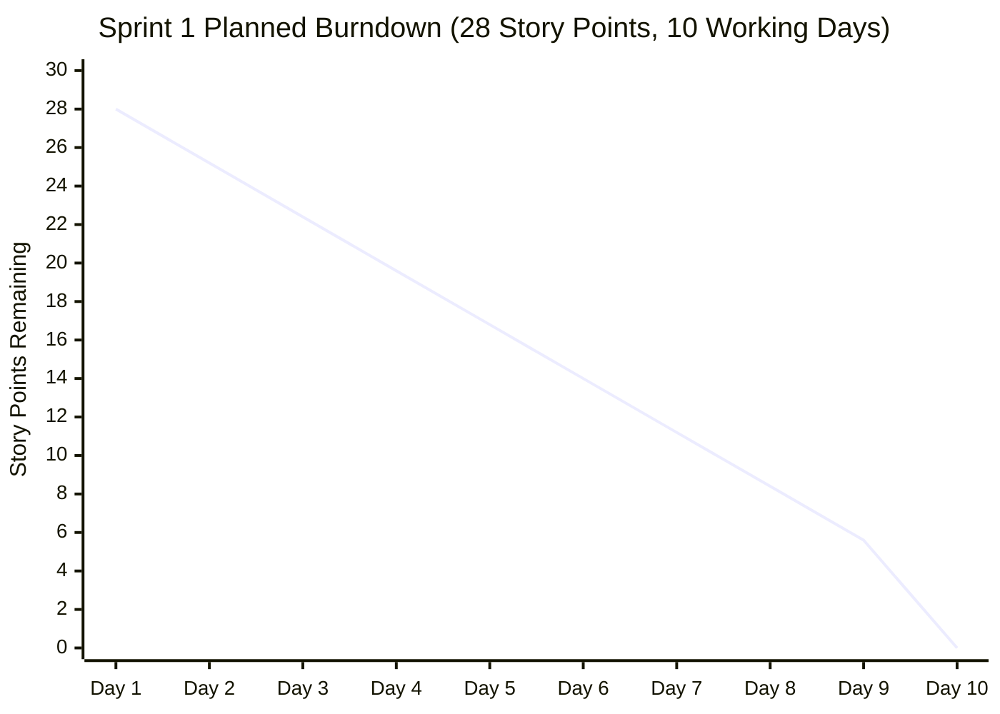

# D3 Project Plan & Sprint Roadmap

**Deliverable:** D3 — Project Planning  
**Authors:** Arnav Mishra, Keshav Singhal  
**Methodology:** Agile Scrum — 3 Sprints aligned with D4, D5, D6  
**Product:** Footprint Lens — Contextual Choice Coach

---

## 1. Team Structure (2 Active Members)

| Team Member | Primary Role | Secondary Role | Key Ownership Areas |
|-------------|-------------|----------------|---------------------|
| **Arnav Mishra** | Product Owner & Research Lead | UI/UX & Documentation | Requirements traceability, evaluation design, report writing, domain model design, accessibility, strategic coordination |
| **Keshav Singhal** | Scrum Master & Engineering Lead | Test & Build Engineer | JavaFX architecture, `CarbonService` implementation, persistence (`LocalStore`), test harness, Maven build, CI pipeline |

> Both members share responsibility for UX, accessibility, localisation, and evaluation quality. Work allocation ensures at least 3 meaningful contribution opportunities per person per deliverable.

---

## 2. Three-Sprint Implementation Roadmap

The implementation is partitioned into **3 sprints**, each aligned with a deliverable submission:

| Sprint | Deliverable | Duration | Focus & Value Increment |
|--------|-------------|----------|------------------------|
| **Sprint 1** | D4: Increment 1 | 2 weeks | Core vertical slice — record activities, calculate estimates, transparent provenance, protected choice handling, local persistence. Users can record, view, and trust a carbon estimate. |
| **Sprint 2** | D5: Increment 2 | 2 weeks | Breadth and depth — household scope aggregation, action coaching engine, multi-category support, boundary/partition testing, Definition of Done. |
| **Sprint 3** | D6: Increment 3 | 2 weeks | Polish and release — dashboard summary, accessibility audit, user guide, expanded automated tests, acceptance criteria testing, release candidate. |

### Sprint Roadmap Diagram

---

## 3. User Story Prioritisation (MoSCoW)

Stories are carried forward from D2, prioritised using MoSCoW, and allocated to sprints:

| Story | Epic | Summary | Priority | Sprint | Owner |
|-------|------|---------|----------|--------|-------|
| US-01 | E1: Core | Record activity with category, quantity, scope | **Must** | 1 | Keshav |
| US-02 | E1: Core | Mark activity as protected choice | **Must** | 1 | Keshav |
| US-03 | E2: Provenance | Inspect emission factor source, year, geography | **Must** | 1 | Arnav |
| US-07 | E4: Circular | Record repair/reuse with descriptive (no fake CO₂e) | **Must** | 1 | Arnav |
| US-12 | E7: Persistence | Save and reload records from local CSV | **Must** | 1 | Keshav |
| US-05 | E3: Household | View undivided household aggregate total | **Must** | 2 | Keshav |
| US-08 | E5: Coaching | Receive actionable reduction advice | **Should** | 2 | Arnav |
| US-09 | E5: Coaching | No punitive advice for protected choices | **Must** | 2 | Arnav |
| US-04 | E2: Provenance | See VERIFIED/ILLUSTRATIVE badge on factors | **Should** | 2 | Keshav |
| US-06 | E3: Household | Record multiple categories in same session | **Should** | 2 | Keshav |
| US-10 | E6: Dashboard | View footprint summary by category | **Could** | 3 | Arnav |
| US-11 | E6: Dashboard | Compare against regional benchmarks | **Could** | 3 | Arnav |
| US-13 | E8: Accessibility | Keyboard navigation, large text, high contrast | **Should** | 3 | Keshav |

---

## 4. Sprint 1 Detailed Backlog (D4)

Sprint 1 delivers the **core vertical slice**: a user can record an activity, see a carbon estimate, inspect the factor provenance, mark a protected choice, record a repair descriptively, and have records persist locally.

### Sprint Goal
> "A user can record a carbon-emitting activity, see a transparent estimate with provenance, mark protected choices, record descriptive circular activities, and have all records saved locally."

### Story Point Sizing (Fibonacci: 1, 2, 3, 5, 8)

| Task ID | Story | Task Description | Points | Owner | Acceptance Criteria |
|---------|-------|-----------------|:------:|-------|---------------------|
| T1.1 | US-01 | Implement Activity recording form in JavaFX (category dropdown, quantity field, scope toggle, notes) | 5 | Keshav | Form validates positive quantity; rejects empty/negative input; submits cleanly |
| T1.2 | US-01 | Wire form submission to `CarbonService.estimate()` and display result in table | 3 | Keshav | Estimate appears in table row with correct value and unit |
| T1.3 | US-02 | Add protected choice checkbox; pass flag to Activity record | 2 | Keshav | Checkbox toggles `protectedChoice`; flag stored in Activity |
| T1.4 | US-03 | Create provenance detail view showing Factor source, year, geography, status | 5 | Arnav | Clicking an activity row shows factor details in a panel/dialog |
| T1.5 | US-07 | Support CIRCULAR category with `Estimate.unavailable()` path | 3 | Arnav | Selecting repair/reuse category creates descriptive record with explanation |
| T1.6 | US-12 | Implement `LocalStore.save()` and `LocalStore.load()` with atomic writes | 5 | Keshav | Records persist to CSV; app reload shows saved records |
| T1.7 | — | Write JUnit 5 unit tests for CarbonService, Factor, Estimate | 3 | Arnav | ≥10 tests pass covering calculation, provenance, unavailable states |
| T1.8 | — | Create run scripts (`.bat`, `.ps1`) and verify build on clean machine | 2 | Keshav | `mvn clean verify` passes; app launches from scripts |

**Total Sprint 1 Velocity: 28 story points** (2 developers × 2 weeks × ~7 pts/week capacity)

### Sprint 1 Burndown Chart

> **Note:** This is the planned ideal burndown line. Actual burndown will be tracked during Sprint 1 execution and reported in D4.

---

## 5. Sprint Deliverables & Value Verification

| Sprint | Deliverable | Demo-able Value | Acceptance Gate |
|--------|-------------|-----------------|-----------------|
| **Sprint 1 → D4** | Working JavaFX app with core recording, provenance, protected choice, persistence | User records 120 kWh electricity → sees 98.4 kg CO₂e → inspects CEA factor → marks protected commute → reopens app and data persists | ≥10 unit tests pass; app compiles and runs; CSV round-trip verified |
| **Sprint 2 → D5** | Household aggregation, action coaching, multi-category, boundary tests | User views undivided household total → receives coaching that respects constraints → boundary/partition tests pass → DoD applied | Boundary/partition tests for all numeric inputs; acceptance criteria tested |
| **Sprint 3 → D6** | Dashboard, accessibility, user guide, release candidate | User views category breakdown → navigates by keyboard → reads user guide → app handles all error states gracefully | Full acceptance criteria coverage; user guide complete; zero critical defects |

---

## 6. Definition of Ready (DoR)

A user story enters a sprint only when:
1. Linked to an approved D1/D2 persona and need
2. Written in standard format: "As a [role], I want [capability], so that [value]"
3. Has testable acceptance criteria (Given-When-Then)
4. All dependencies and data models defined
5. Sized ≤ 8 story points (decompose if larger)

## 7. Definition of Done (DoD)

A story is **Done** when:
1. Code written following Java 21 conventions; domain code has zero `javafx.*` imports
2. Unit tests written and passing with all assertions
3. Code reviewed by the other team member
4. `mvn clean verify` passes with zero errors
5. Documentation updated (architecture, user guide, or report as applicable)
6. Commit message follows conventional format (e.g., `feat(core): add activity recording`)

---

## 8. Scrum Ceremonies

| Ceremony | Frequency | Participants | Duration | Output |
|----------|-----------|--------------|----------|--------|
| Sprint Planning | Start of each sprint | Arnav, Keshav | 1 hour | Committed sprint backlog |
| Weekly Check-in | Weekly (lab session) | Arnav, Keshav | 20 min | Progress update, blockers, decisions |
| Sprint Review | End of each sprint | Arnav, Keshav | 45 min | Working demo, story sign-off |
| Sprint Retrospective | End of each sprint | Arnav, Keshav | 30 min | Start/Stop/Continue actions |
| Peer Review | Weekly | Arnav, Keshav | 15 min | Feedback recorded for PRISM |

---

*Authors: Arnav Mishra (story prioritisation, sprint allocation, roadmap), Keshav Singhal (story point sizing, burndown, DoR/DoD)*
