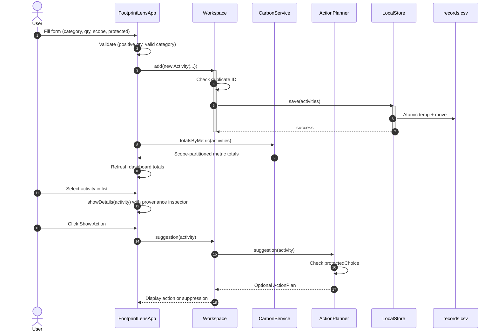
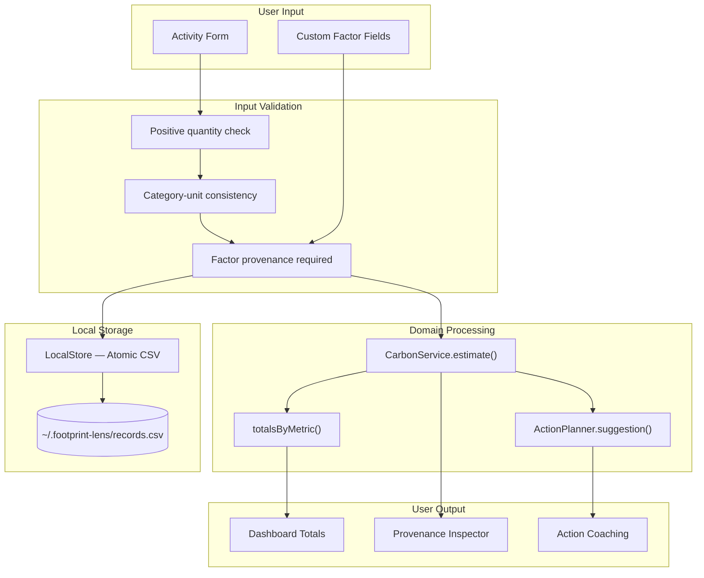

# D4 Architecture — Design Evolution from D3

**Deliverable:** D4 — Technical Design Update
**Authors:** Arnav Mishra, Keshav Singhal
**Version:** v0.2.0 (Post-Sprint 1)

---

## 1. Architecture Validation

Sprint 1 implementation **confirmed all five D3 ADRs** without requiring architectural changes. The Clean Layered Architecture (Presentation → Service → Domain → Persistence) successfully:

- Enabled 14 headless JUnit 5 tests running in &lt;200ms (ADR-01)
- Prevented mutation bugs through immutable Java 21 records (ADR-02)
- Maintained deterministic 10 × 0.716 = 7.160 BigDecimal arithmetic (ADR-03)
- Suppressed punitive advice for protected choices via ActionPlanner (ADR-04)
- Persisted all data locally with zero network calls (ADR-05)

## 2. Design Refinements (D4)

### DR-01: Category-Aware Factor Gating

**Context:** The `Activity` record constructor enforces `factor != null` only for `ELECTRICITY`. All other categories produce `Estimate.unavailable()`.

**Rationale:** Deliberate design constraint. D1 research identified that reliable region-specific Indian emission factors for food, water, and transport are scarce (D1 Theme T3: "Data Provenance Gap"). Rather than fabricating proxy factors, the system maintains epistemic honesty.

**Sprint 2 evolution:** Extend the numeric path to TRAVEL once verified TERI/MoEFCC factors are sourced and documented.

### DR-02: Tri-Mode UI Architecture

**Context:** `FootprintLensApp.ViewMode` enum supports D3_BASELINE, D4_INCREMENT_1, and D5_INCREMENT_2 modes.

**Pattern:** Strategy pattern applied to UI theming and feature gating — each mode shows/hides features and applies distinct CSS styling via `.d3-mode`, `.d4-mode`, `.d5-mode` class selectors.

### DR-03: Workspace as Application State Manager

**Context:** `Workspace` class separates in-memory state management from JavaFX observable collections. It owns the lifecycle of activities, chosen/dismissed actions, and delegates persistence to `LocalStore`.

**Benefit:** UI can be replaced without touching state logic. `Workspace` is independently testable.

## 3. Component Interaction — Updated Sequence Diagram



## 4. Package Structure

```text
in.carbon
├── core/                          # PURE DOMAIN (zero JavaFX)
│   ├── ActionPlan.java            # 18 lines — recommendation record
│   ├── ActionPlanner.java         # 24 lines — deterministic rules
│   ├── Activity.java              # 34 lines — validated activity record
│   ├── CarbonService.java         # 92 lines — calculation facade
│   ├── Category.java              # 26 lines — 7 lifestyle categories
│   ├── Estimate.java              # 29 lines — emission estimate
│   ├── Factor.java                # 31 lines — provenance-carrying factor
│   ├── FactorStatus.java          # 13 lines — VERIFIED/ILLUSTRATIVE/USER_SUPPLIED
│   ├── LocalStore.java            # 132 lines — atomic CSV persistence
│   ├── Scope.java                 # 14 lines — PERSONAL/HOUSEHOLD
│   └── Workspace.java             # 56 lines — application state
│
└── ui/
    └── FootprintLensApp.java      # 938 lines — JavaFX presentation
```

**Metrics:** 11 domain classes (445 lines, zero JavaFX imports) + 1 UI class (938 lines). Domain-to-UI ratio: 0.47:1.

## 5. Data Flow Diagram



---

*Authors: Arnav Mishra (architecture validation, design refinements), Keshav Singhal (sequence diagram, metrics, data flow)*
