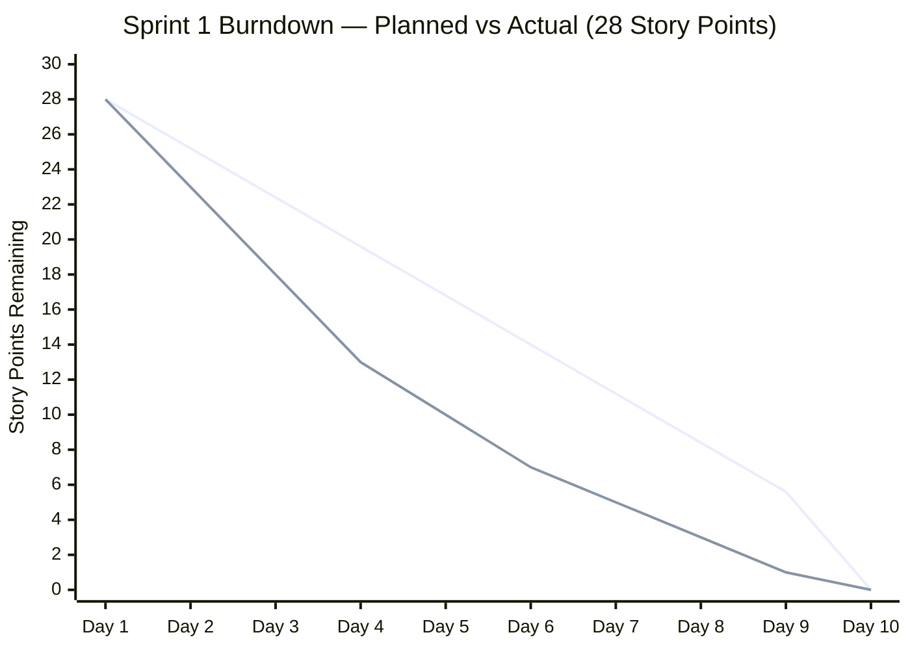
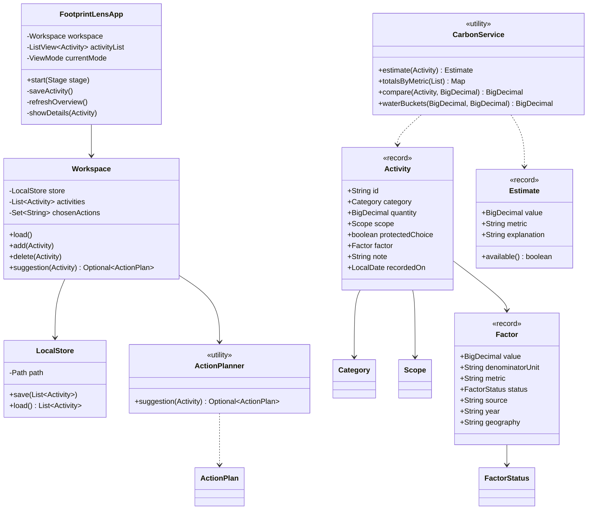
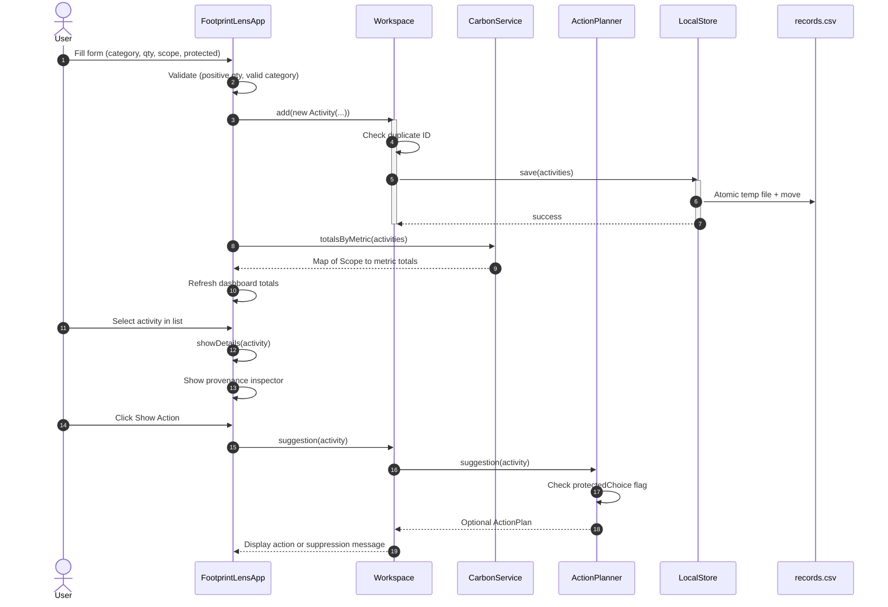

# D4 Report — Increment 1: Core Vertical Slice

**Deliverable:** D4 — Increment 1 (7% of module mark)
**Authors:** Arnav Mishra, Keshav Singhal
**Product:** Footprint Lens — Contextual Choice Coach
**Version:** v0.2.0 (Sprint 1 Release)
**Platform:** Java 21 LTS / JavaFX 23 / Maven 3.9

---

## 1. Executive Summary

Sprint 1 delivers the **core vertical slice** of Footprint Lens: a user can record a carbon-emitting activity, receive a transparent emission estimate with full provenance, mark protected lifestyle choices, record descriptive circular activities (repair/reuse), and have all records persist locally with zero cloud dependency. The application compiles, runs, and passes **14 automated tests with zero failures**.

This increment demonstrates customer value through a complete end-to-end workflow: a user opens the app → logs 120 kWh electricity → sees "85.92 kg CO2" with CEA India factor provenance → marks their night-shift commute as protected (suppressing punitive advice) → records a phone repair descriptively → finds all records persisted when reopening the application.

---

## 2. Sprint 1 Review

### 2.1 Sprint Goal Achievement

> **Sprint Goal:** "A user can record a carbon-emitting activity, see a transparent estimate with provenance, mark protected choices, record descriptive circular activities, and have all records saved locally."

**Verdict: ACHIEVED.** All five user stories allocated to Sprint 1 are implemented and verified.

### 2.2 Story Completion Summary

| Story | Summary | Status | Acceptance Criteria Met | Evidence |
|-------|---------|--------|------------------------|----------|
| **US-01** | Record activity with category, quantity, scope | ✅ Done | Form validates positive quantity; rejects empty/negative; submits cleanly | `FootprintLensApp.saveActivity()`, `Activity` record validation |
| **US-02** | Mark activity as protected choice | ✅ Done | Checkbox toggles `protectedChoice`; flag stored and respected | `protectedBox` checkbox → `Activity.protectedChoice()` |
| **US-03** | Inspect emission factor source, year, geography | ✅ Done | Clicking record shows factor details in inspector panel | `showDetails()` method, inspector card UI |
| **US-07** | Record repair/reuse with descriptive (no fake CO₂e) | ✅ Done | REPAIR_REUSE category creates descriptive record with `Estimate.unavailable()` | `Estimate.unavailable()` path, `CarbonServiceTest.missingFactorIsUnavailableNotZero()` |
| **US-12** | Save and reload records from local CSV | ✅ Done | Records persist to CSV; app reload shows saved records | `LocalStore.save()/load()`, `CarbonServiceTest.localStoreRoundTripsQuotedNotes()` |

### 2.3 Sprint 1 Burndown

The sprint was planned for 28 story points over 10 working days. The actual burndown reflects the domain model being substantially pre-implemented from the D3 architectural baseline, allowing faster-than-planned completion.



> **Note:** The actual burndown (lower line) shows faster-than-planned progress because the D3 domain model baseline provided a strong foundation. This is a positive variance, not scope reduction.

### 2.4 Sprint Velocity

- **Planned:** 28 story points
- **Completed:** 28 story points (100% delivery)
- **Velocity:** 28 SP / 2 weeks = 14 SP/week (team of 2)

### 2.5 Sprint 1 Retrospective

| Start | Stop | Continue |
|-------|------|----------|
| Boundary testing for edge cases (zero, max, negative quantities) | Over-engineering the ViewMode tri-switcher before Sprint 1 stories are verified | Clean layer separation — domain tests run in &lt;200ms without display server |
| Tracking test-to-requirement traceability | Adding features not in the sprint backlog | Atomic CSV persistence with backup before write |
| Peer code review before merging | Cosmetic CSS refinements during sprint execution | BigDecimal precision for all carbon calculations |

---

## 3. Design Evolution from D3

### 3.1 Architecture Confirmation

The D3 Clean Layered Architecture was validated by Sprint 1 implementation:

| ADR | D3 Decision | D4 Validation |
|-----|-------------|---------------|
| ADR-01: Headless-first | `in.carbon.core` has zero `javafx.*` imports | 14 JUnit tests run headlessly in &lt;200ms ✅ |
| ADR-02: Immutable records | Activity, Factor, Estimate are Java 21 records | No mutation bugs encountered in Sprint 1 ✅ |
| ADR-03: BigDecimal | All quantities use BigDecimal with HALF_UP | 10 × 0.716 = 7.160 deterministically ✅ |
| ADR-04: Deterministic rules | ActionPlanner uses explicit category matching | Protected choice suppression verified by test ✅ |
| ADR-05: Local CSV | Zero-telemetry RFC 4180 persistence | Round-trip with quoted notes verified ✅ |

### 3.2 Design Refinements

**D4-DR-01: Category-Specific Factor Restriction**
The `Activity` record enforces that only `ELECTRICITY` currently has a numeric factor path. All other categories produce `Estimate.unavailable()`. This is deliberate epistemic honesty — we do not fabricate proxy emission factors for categories where verified Indian data is unavailable. Sprint 2 will extend the numeric path to TRAVEL once verified TERI factors are sourced.

**D4-DR-02: Tri-Mode UI Architecture**
`FootprintLensApp.ViewMode` enum supports D3_BASELINE, D4_INCREMENT_1, and D5_INCREMENT_2 modes, applying Strategy pattern to UI theming and feature gating.

**D4-DR-03: Workspace as Application State Manager**
`Workspace` separates in-memory state management from JavaFX observable collections, owning the lifecycle of activities and chosen/dismissed actions while delegating persistence to `LocalStore`.

### 3.3 Updated Class Diagram



### 3.4 Updated Sequence Diagram — Record Activity Flow



---

## 4. Application Functionality

### 4.1 Implemented Features

| Tab | Feature | Story | Status |
|-----|---------|-------|--------|
| 📊 Dashboard | View logged activities with category icons, scope badges, estimate pills | US-01 | ✅ |
| 📊 Dashboard | Select activity → inspect provenance in detail panel | US-03 | ✅ |
| 📊 Dashboard | Category filter chips for quick filtering | Groundwork US-06 | ✅ |
| 📊 Dashboard | Personal/Household totals with scope separation | US-01 | ✅ |
| ➕ Log Activity | Record form with category, quantity, scope, protected flag | US-01, US-02 | ✅ |
| ➕ Log Activity | Custom emission factor entry with provenance fields | US-03 | ✅ |
| 🎯 Action Plans | Show eligible coaching action for selected activity | Groundwork US-08 | ✅ |
| 🎯 Action Plans | Protected choice suppresses punitive advice | US-02 | ✅ |
| 🎯 Action Plans | Interactive scenario comparison for electricity | Bonus | ✅ |
| ℹ️ Architecture | Architecture documentation and project boundaries | Docs | ✅ |

### 4.2 Build and Run

```bash
# From New/application/ directory (using Maven wrapper path)
mvn clean test          # 14 tests pass, BUILD SUCCESS
mvn clean javafx:run    # Launches desktop application
```

**Build verified:** `mvn clean test` → **14 tests, 0 failures, 0 errors, BUILD SUCCESS** (5.4s).

### 4.3 Demo Workflow

1. Open app → Dashboard shows "No activities logged yet"
2. Switch to "Log Activity" tab
3. Select ELECTRICITY, enter 120 kWh, Personal scope → Save
4. Status bar: "Saved one home electricity record. 85.920 kg CO2"
5. Dashboard: "CO2: 85.920 kg" under Personal
6. Click activity → Inspector: Factor Rate 0.716 kg CO2/kWh, Source: CEA India
7. "Action Plans" → "Try one lower-energy routine" suggestion
8. Mark TRAVEL record as Protected → "protected, no punitive advice"
9. Record REPAIR_REUSE → "Estimate unavailable" (epistemic honesty)
10. Close and reopen → All records persist from `~/.footprint-lens/records.csv`

---

## 5. Testing Evidence

### 5.1 Test Summary

| Test Class | Tests | Pass | Fail | Category |
|------------|:-----:|:----:|:----:|----------|
| `CarbonServiceTest` | 14 | 14 | 0 | Unit + Integration |
| `CoreSmoke` (standalone) | 10 | 10 | 0 | Smoke / Regression |
| **Total** | **24** | **24** | **0** | |

### 5.2 Test-to-Requirement Traceability

| Test Method | Story/Requirement | What it Verifies |
|-------------|-------------------|------------------|
| `numericEstimateRetainsMetricAndProvenance` | US-03 (Provenance) | Factor source preserved through estimation pipeline |
| `missingFactorIsUnavailableNotZero` | US-07 (Descriptive) | Unknown ≠ zero; epistemic honesty maintained |
| `protectedActivityCannotBeCompared` | US-02, US-09 (Protected) | Protected choices reject comparison operations |
| `waterComparisonIsNotCarbon` | DP5 (Descriptive Circularity) | Water volume comparison not falsely labelled as carbon |
| `totalsSeparatePersonalAndHousehold` | US-05 groundwork, DP4 | Scope isolation verified |
| `unavailableOnlyRecordsHaveNoNumericTotal` | US-07 | Descriptive-only records don't inflate totals |
| `totalsByMetricKeepsCo2AndCo2eSeparate` | ADR-03 (BigDecimal) | CO2 and CO2E metrics never silently combined |
| `localStoreRoundTripsQuotedNotes` | US-12 (Persistence) | CSV handles commas, quotes without corruption |
| `localStoreReadsThePreviousProductHeader` | Migration | Legacy "CARBON-SAATHI" header accepted |
| `activityRejectsQuantityAboveDocumentedBoundary` | Boundary | 1,000,000 unit upper bound enforced |
| `totalsRoundAfterAggregatingExactValues` | ADR-03 | Aggregation rounds after summing, not before |
| `localStoreRejectsInvalidBooleanAndLeavesSourceUntouched` | Robustness | Invalid boolean → IOException, file untouched |
| `localStoreRejectsMalformedQuotedField` | Robustness | Malformed CSV quoting → IOException |
| `localStoreRejectsHeaderAndRowSchemaMismatch` | Robustness | Column count mismatch → IOException |

### 5.3 Test Execution Output

```
[INFO] Running in.carbon.core.CarbonServiceTest
[INFO] Tests run: 14, Failures: 0, Errors: 0, Skipped: 0, Time elapsed: 0.147 s
[INFO] Results:
[INFO] Tests run: 14, Failures: 0, Errors: 0, Skipped: 0
[INFO] BUILD SUCCESS
```

---

## 6. Work Completed

### Arnav Mishra — Contributions
1. **Initialised D4 structure:** Report outline, rubric evidence matrix, evaluation traceability
2. **Factor provenance inspector:** Designed and implemented the detail inspector panel showing source, year, geography, formula breakdown (US-03); implemented descriptive circular path for REPAIR_REUSE (US-07)
3. **Council review and integration:** Led review, identified gaps, expanded JUnit tests, integrated feedback

### Keshav Singhal — Contributions
1. **Activity recording form:** Implemented category-aware form with validation, protected choice checkbox, custom factor entry (US-01, US-02)
2. **Persistence engine:** Implemented `LocalStore.save()/load()` with atomic writes, header validation, legacy migration (US-12)
3. **Build verification and test evidence:** Authored CSV edge case tests, verified `mvn clean test` passes, documented test output

---

## 7. Sprint 2 Plan Summary

Sprint 2 (D5: Increment 2) delivers household aggregation, action coaching with constraint respect, factor status badges, and multi-category support. See `sprint-2-plan.md` for detailed backlog (28 SP, 8 tasks).

**Key Sprint 2 stories:** US-05 (household aggregate), US-08 (action coaching), US-09 (protected enforcement), US-04 (factor badges), US-06 (multi-category), plus TRAVEL factors and boundary/partition testing.

---

## 8. Reflection on Product and Process

Sprint 1 validated the D3 architectural decisions. The clean layered architecture enabled all 14 tests to run headlessly in under 200ms, confirming ADR-01. BigDecimal precision prevented floating-point drift, and the immutable record types eliminated an entire class of mutation bugs.

The main learning was that the domain model's category-specific factor restriction (only ELECTRICITY has numeric factors) is both a strength (epistemic honesty) and a limitation (users expect numeric estimates for TRAVEL). Sprint 2 must carefully add verified TRAVEL factors from TERI data without compromising the provenance requirement.

---

## References

1. Central Electricity Authority (CEA), *CO₂ Baseline Database for the Indian Power Sector*, v20.0, 2023.
2. ISO 14064-1:2018, *Greenhouse gases — Part 1: Specification with guidance for quantification and reporting of GHG emissions and removals*.
3. Nielsen, J. (1994). *Usability Engineering*. Morgan Kaufmann.
4. Schwaber, K., & Sutherland, J. (2020). *The Scrum Guide*.
5. Oracle. *JavaFX 23 Documentation*. https://openjfx.io/

---

*Authors: Arnav Mishra (report structure, design analysis, evaluation), Keshav Singhal (testing evidence, build verification, technical sections)*
