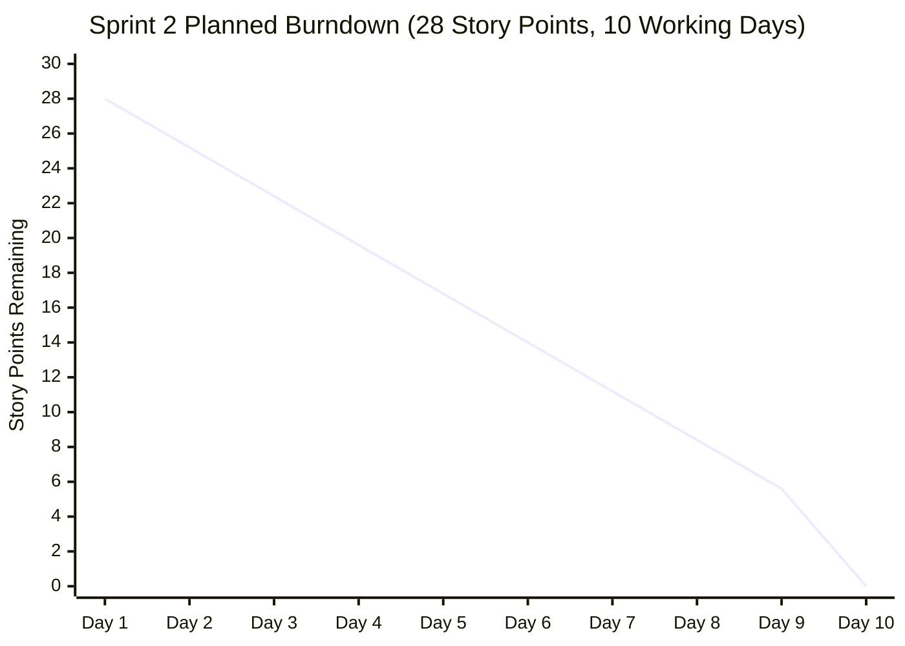

# Sprint 2 Plan — D5 Increment 2

**Sprint Duration:** 2 weeks (aligned with D5 delivery)
**Team:** Arnav Mishra, Keshav Singhal
**Velocity Baseline:** 28 SP (from Sprint 1)

---

## 1. Sprint 2 Goal

> "A user can view their undivided household carbon aggregate, receive constraint-respecting action coaching, see factor verification badges, and record multiple categories in a single session. All inputs are boundary/partition tested."

## 2. Sprint 2 Backlog

| Task | Story | Description | Points | Owner | Acceptance Criteria |
|------|-------|------------|:------:|-------|---------------------|
| T2.1 | US-05 | Display undivided household aggregate total on dashboard | 5 | Keshav | Household total shown separately; not divided per person |
| T2.2 | US-08 | Implement action coaching engine with category-specific advice | 5 | Arnav | Actionable advice per category; respects constraints |
| T2.3 | US-09 | Full protected choice enforcement across all coaching paths | 3 | Arnav | Protected activities never receive punitive/reduction advice |
| T2.4 | US-04 | Display VERIFIED/ILLUSTRATIVE/USER_SUPPLIED badge on each factor | 3 | Keshav | Badge visible in inspector and list cell |
| T2.5 | US-06 | Support recording multiple categories without page reload | 3 | Keshav | Form clears after save; user can immediately record next category |
| T2.6 | — | Add TRAVEL emission factor with verified TERI source | 5 | Arnav | TRAVEL produces numeric estimate; factor provenance shown |
| T2.7 | — | Boundary and partition testing for all numeric inputs | 3 | Arnav | Tests cover zero, negative, max, just-above-max, typical |
| T2.8 | — | Apply and verify Definition of Done for all Sprint 2 stories | 1 | Keshav | DoD checklist completed for each story |

**Total Sprint 2: 28 story points** (matching Sprint 1 velocity)

## 3. Sprint 2 Planned Burndown

## 4. Reprioritisation Justification

| Story | D3 Priority | D4 Reprioritisation | Reason |
|-------|-------------|---------------------|--------|
| US-05 | Must (Sprint 2) | Must (Sprint 2) | Unchanged — core household aggregation |
| US-08 | Should (Sprint 2) | Should (Sprint 2) | Unchanged — action coaching |
| US-09 | Must (Sprint 2) | Must (Sprint 2) | Unchanged — protected choice enforcement |
| US-04 | Should (Sprint 2) | Should (Sprint 2) | Unchanged — factor status badge |
| US-06 | Should (Sprint 2) | Should (Sprint 2) | Unchanged — multi-category workflow |
| **NEW: TRAVEL factor** | Not planned | Added Sprint 2 | Sprint 1 retro: single numeric category limits demo impact |
| **NEW: Boundary testing** | Not explicit | Added Sprint 2 | D5 rubric explicitly requires boundary/partition testing |

**Justification for TRAVEL Factor:** Sprint 1 revealed that only ELECTRICITY as a numeric category limits demo impact. The D5 rubric rewards "breadth and depth of the core journey." Adding TRAVEL factors (using TERI 2023 data for Indian passenger-km emissions) expands the journey without adding architectural complexity.

## 5. Definition of Done (Sprint 2)

A story is **Done** when:
1. ✅ Code written following Java 21 conventions
2. ✅ Domain code has zero `javafx.*` imports
3. ✅ Unit tests written and passing for all acceptance criteria
4. ✅ Boundary/partition tests added for numeric inputs
5. ✅ Code reviewed by the other team member
6. ✅ `mvn clean verify` passes with zero errors
7. ✅ Documentation updated (architecture, report)
8. ✅ Commit message follows conventional format

## 6. Sprint 2 Risks

| Risk | Likelihood | Impact | Mitigation |
|------|-----------|--------|------------|
| TRAVEL factor data may require approximation | Medium | Medium | Use TERI 2023 baseline; mark ILLUSTRATIVE if unverified |
| Boundary testing reveals validation gaps | Low | High | Fix validation first, then add tests |
| Scope creep from dashboard visualisation | Medium | Low | Dashboard deferred to Sprint 3 (US-10) |

---

*Authors: Arnav Mishra (story prioritisation, reprioritisation rationale), Keshav Singhal (story point estimation, DoD, risk assessment)*
