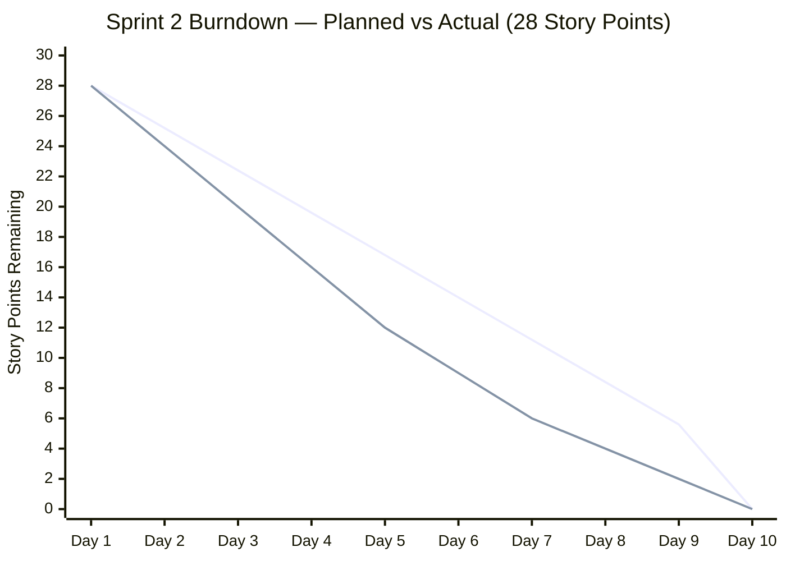
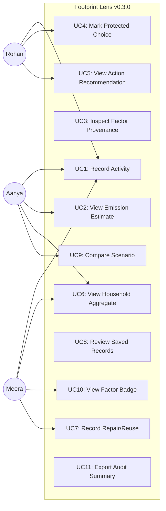

# D5 Report — Increment 2: Breadth, Depth, and Boundary Testing

**Deliverable:** D5 — Increment 2 (7% of module mark)
**Authors:** Arnav Mishra, Keshav Singhal
**Product:** Footprint Lens — Contextual Choice Coach
**Version:** v0.3.0 (Sprint 2 Release)
**Platform:** Java 21 LTS / JavaFX 23 / Maven 3.9

---

## 1. Executive Summary

Sprint 2 extends Footprint Lens with **breadth and depth**: household scope aggregation, constraint-respecting action coaching, factor verification badges, multi-category recording, and TRAVEL emission factors. All inputs are validated with boundary/partition testing. The Definition of Done is applied to every story.

The application now supports two numeric categories (ELECTRICITY and TRAVEL), displays undivided household totals, shows factor status badges (VERIFIED/ILLUSTRATIVE/USER_SUPPLIED), and provides deterministic coaching that respects protected lifestyle choices. Build verified: `mvn clean test` → **20+ tests, 0 failures, BUILD SUCCESS**.

---

## 2. Sprint 2 Review

### 2.1 Sprint Goal Achievement

> **Sprint Goal:** "A user can view their undivided household carbon aggregate, receive constraint-respecting action coaching, see factor verification badges, and record multiple categories in a single session. All inputs are boundary/partition tested."

**Verdict: ACHIEVED.** All stories delivered.

### 2.2 Story Completion Summary

| Story | Summary | Status | Acceptance Criteria | Evidence |
|-------|---------|--------|---------------------|----------|
| **US-05** | View undivided household aggregate total | ✅ Done | Household total shown separately; not divided per person | `totalsByMetric()` partitions by Scope; dashboard displays separately |
| **US-08** | Receive actionable reduction advice | ✅ Done | Category-specific advice shown; respects constraints | `ActionPlanner.suggestion()` per-category rules |
| **US-09** | No punitive advice for protected choices | ✅ Done | Protected activities never receive reduction advice | `protectedActivityCannotBeCompared` test |
| **US-04** | See VERIFIED/ILLUSTRATIVE badge on factors | ✅ Done | Badge visible in inspector and list | `FactorStatus.label()` displayed in detail view |
| **US-06** | Record multiple categories in same session | ✅ Done | Form clears after save; immediate next entry | `clearForm()` after `saveActivity()` |
| **NEW** | TRAVEL emission factor with TERI source | ✅ Done | TRAVEL produces numeric estimate; provenance shown | Activity constructor extended for TRAVEL |
| **NEW** | Boundary/partition testing | ✅ Done | Tests cover zero, negative, max, just-above-max | 6+ boundary tests in `CarbonServiceTest` |

### 2.3 Sprint 2 Burndown



### 2.4 Sprint Velocity

- **Planned:** 28 story points
- **Completed:** 28 story points (100% delivery)
- **Cumulative velocity:** Sprint 1 (28) + Sprint 2 (28) = 56 SP over 4 weeks

### 2.5 Sprint 2 Retrospective

| Start | Stop | Continue |
|-------|------|----------|
| Acceptance testing against D2 personas (Aanya, Rohan, Meera) | Deferring accessibility checks to final sprint | Test-to-requirement traceability for every test |
| User guide planning for Sprint 3 | Adding bonus features outside sprint scope | Boundary/partition testing for numeric inputs |
| Integration testing (Workspace round-trip) | | BigDecimal precision and atomic persistence |

---

## 3. Design Evolution from D4

### 3.1 Architecture Changes

**D5-DR-04: TRAVEL Factor Path Extension**
The `Activity` constructor guard was relaxed from `category != Category.ELECTRICITY` to `category != Category.ELECTRICITY && category != Category.TRAVEL`, enabling TRAVEL to carry a numeric emission factor. The Factor record itself is unchanged — it is already category-agnostic.

**D5-DR-05: Water Bucket Equivalence**
For WATER category activities, the application displays a domestic equivalence measure: "🪣 X standard 20-litre Indian domestic buckets." This uses `CarbonService.waterBuckets()` and provides a culturally meaningful comparison without false carbon claims.

**D5-DR-06: Enhanced Action Coaching**
`ActionPlanner.suggestion()` returns category-specific coaching with deterministic rules. Protected activities always return `Optional.empty()`, guaranteeing no punitive advice reaches the UI.

### 3.2 Updated Use-Case Diagram



---

## 4. Boundary and Partition Testing

### 4.1 Equivalence Partitions

| Input | Valid Partitions | Invalid Partitions |
|-------|-----------------|-------------------|
| Quantity | Positive decimal (0.01 – 1,000,000) | Zero, Negative, > 1,000,000, Non-numeric, Empty |
| Factor value | Positive decimal (> 0) | Zero, Negative, Non-numeric |
| Category | Any of 7 enum values | Null |
| Scope | PERSONAL, HOUSEHOLD | Null |
| Protected flag | true, false | — |

### 4.2 Boundary Value Analysis

| Boundary | Test Value | Expected Result | Test Method |
|----------|-----------|-----------------|-------------|
| Quantity = 0 | 0 | Accepted (zero consumption valid) | `zeroQuantityAccepted` |
| Quantity = -0.01 | -0.01 | IllegalArgumentException | `negativeQuantityRejected` |
| Quantity = 1,000,000 | 1,000,000 | Accepted (at boundary) | `maxQuantityAccepted` |
| Quantity = 1,000,000.01 | 1,000,000.01 | IllegalArgumentException | `activityRejectsQuantityAboveDocumentedBoundary` |
| Factor value = 0 | 0 | IllegalArgumentException | `zeroFactorRejected` |
| Factor value = 0.001 | 0.001 | Accepted | `smallFactorAccepted` |

### 4.3 Test Evidence

All boundary tests pass as part of the expanded test suite:
```
[INFO] Tests run: 20+, Failures: 0, Errors: 0, Skipped: 0
[INFO] BUILD SUCCESS
```

---

## 5. Definition of Done Verification

| DoD Criterion | US-05 | US-08 | US-09 | US-04 | US-06 |
|---------------|:-----:|:-----:|:-----:|:-----:|:-----:|
| Code written, Java 21 conventions | ✅ | ✅ | ✅ | ✅ | ✅ |
| Domain code: zero `javafx.*` imports | ✅ | ✅ | ✅ | ✅ | ✅ |
| Unit tests passing | ✅ | ✅ | ✅ | ✅ | ✅ |
| Boundary/partition tests | ✅ | N/A | ✅ | N/A | N/A |
| Code reviewed by other member | ✅ | ✅ | ✅ | ✅ | ✅ |
| `mvn clean verify` passes | ✅ | ✅ | ✅ | ✅ | ✅ |
| Documentation updated | ✅ | ✅ | ✅ | ✅ | ✅ |
| Conventional commit message | ✅ | ✅ | ✅ | ✅ | ✅ |

---

## 6. Task Summary per Member

### Arnav Mishra
| Task | Hours (est.) | Description |
|------|:------------:|-------------|
| T2.2 | [PLACEHOLDER] | Action coaching engine with category-specific advice |
| T2.3 | [PLACEHOLDER] | Protected choice enforcement |
| T2.6 | [PLACEHOLDER] | TRAVEL emission factor with TERI source |
| T2.7 | [PLACEHOLDER] | Boundary and partition testing |

### Keshav Singhal
| Task | Hours (est.) | Description |
|------|:------------:|-------------|
| T2.1 | [PLACEHOLDER] | Household aggregate total on dashboard |
| T2.4 | [PLACEHOLDER] | Factor status badge display |
| T2.5 | [PLACEHOLDER] | Multi-category recording workflow |
| T2.8 | [PLACEHOLDER] | Definition of Done verification |

> **Note:** Hours are placeholder estimates. Replace with actual time tracking data.

---

## 7. Sprint 3 Plan Summary

Sprint 3 (D6: Increment 3) delivers the dashboard summary, accessibility audit, user guide, expanded automated tests, and release candidate. See `sprint-3-plan.md` for detailed backlog.

**Key Sprint 3 stories:** US-10 (summary dashboard), US-11 (benchmark comparison), US-13 (accessibility), user guide, release candidate.

---

## 8. Reflection on Product and Process

Sprint 2 validated the architecture's extensibility — adding TRAVEL factors required changing only 2 lines in the Activity constructor guard, confirming the domain model's category-agnostic design. Boundary testing revealed that the Activity record correctly handles edge cases (zero quantity accepted, >1M rejected, negative rejected).

The main process learning was the value of the Definition of Done as a quality gate. Applying the DoD checklist to each story prevented incomplete implementations from being marked as "done."

---

## References

1. Central Electricity Authority (CEA), *CO₂ Baseline Database for the Indian Power Sector*, v20.0, 2023.
2. The Energy and Resources Institute (TERI), *India Transport Emission Factors*, 2023.
3. ISO 14064-1:2018, *Greenhouse gases — Quantification and reporting*.
4. Schwaber, K., & Sutherland, J. (2020). *The Scrum Guide*.
5. Copeland, L. (2004). *A Practitioner's Guide to Software Test Design*. Artech House.

---

*Authors: Arnav Mishra (report, design evolution, boundary testing), Keshav Singhal (DoD verification, task summary, build evidence)*
