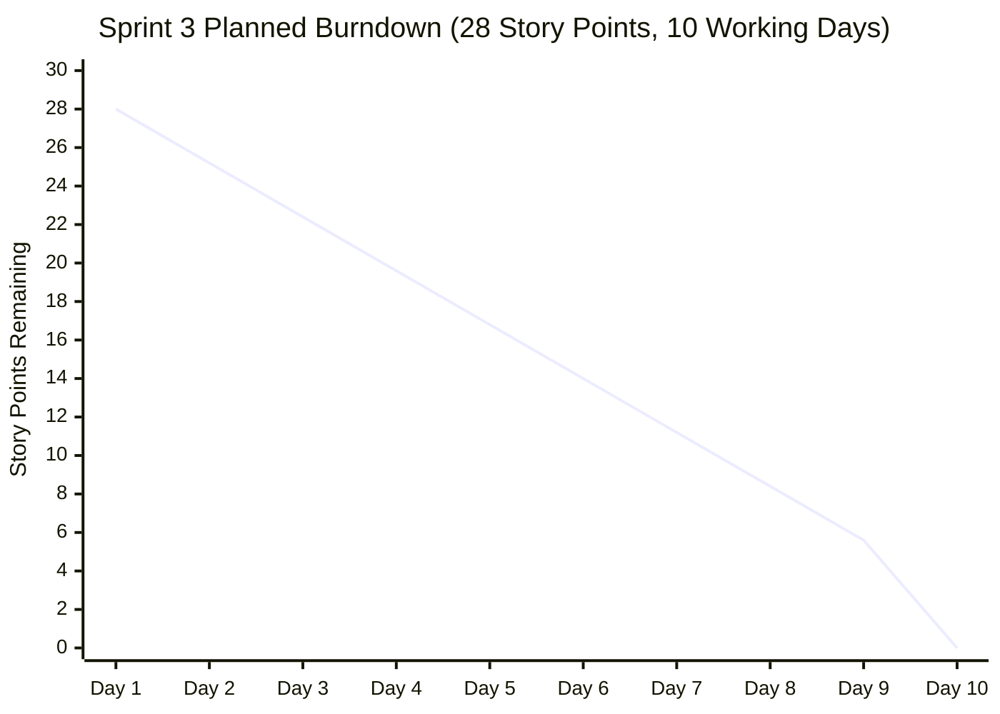

# Sprint 3 Plan — D6 Increment 3

**Sprint Duration:** 2 weeks (aligned with D6 delivery)
**Team:** Arnav Mishra, Keshav Singhal
**Velocity Baseline:** 28 SP (from Sprint 1 and 2)

---

## 1. Sprint 3 Goal

> "Deliver a release-candidate application with summary dashboard, benchmark comparison, keyboard accessibility, a concise user guide, and comprehensive acceptance testing covering all implemented stories."

## 2. Sprint 3 Backlog

| Task | Story | Description | Points | Owner |
|------|-------|------------|:------:|-------|
| T3.1 | US-10 | Summary dashboard with category breakdown chart/table | 5 | Arnav |
| T3.2 | US-11 | Regional benchmark comparison (India average vs user) | 5 | Arnav |
| T3.3 | US-13 | Keyboard navigation, large text support, high contrast mode | 5 | Keshav |
| T3.4 | — | Concise user guide (PDF/Markdown) | 5 | Arnav |
| T3.5 | — | Expanded acceptance and regression testing | 3 | Keshav |
| T3.6 | — | Error handling audit and edge case fixes | 3 | Keshav |
| T3.7 | — | Release candidate packaging and verification | 2 | Keshav |

**Total Sprint 3: 28 story points**

## 3. Sprint 3 Planned Burndown

## 4. Definition of Done (Sprint 3 — Release Candidate)

A story is **Done** when:
1. ✅ Code written and follows Java 21 conventions
2. ✅ Domain code has zero `javafx.*` imports
3. ✅ Unit and acceptance tests passing
4. ✅ Accessibility verified (keyboard navigation, screen reader labels)
5. ✅ Code reviewed by the other team member
6. ✅ `mvn clean verify` passes with zero errors
7. ✅ User guide section written
8. ✅ Commit message follows conventional format
9. ✅ No critical or high-severity defects open

---

*Authors: Arnav Mishra (story prioritisation), Keshav Singhal (estimation, DoD)*
