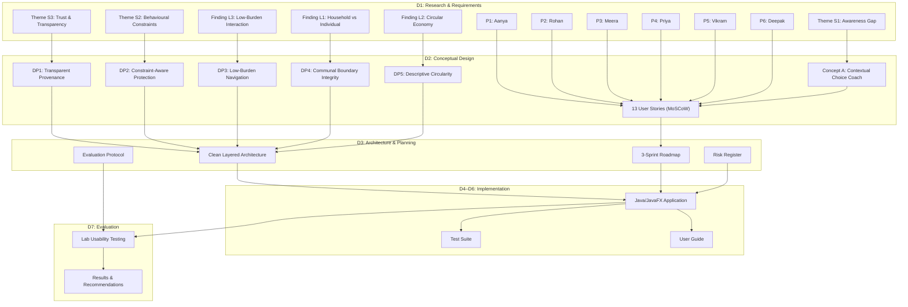

# End-to-End Traceability Chain: D1 → D2 → D3–D7

**Date:** 2026-11-20  
**Purpose:** Demonstrate coherent design lineage from D1 research through D7 evaluation  
**Team:** Arnav Mishra, Keshav Singhal

---

## 1. D1 Research Foundation → D2 Design Concepts

### D1 Themes and Stakeholder Needs

| D1 Theme | Key Finding | Stakeholder Need | Personas |
|----------|-------------|------------------|----------|
| **S1: Environmental Awareness Gap** | Indian households lack contextualised, locally relevant carbon footprint data. National averages obscure individual household patterns. | Users need region-specific, transparent emission data tied to their actual consumption patterns. | P1 (Aanya — urban student), P3 (Meera — working mother) |
| **S2: Behavioural Constraints** | Many high-emission activities (night-shift commute, medical equipment, cooking fuel) are non-discretionary. Users feel blamed for choices they cannot change. | System must distinguish protected/constrained choices from discretionary consumption and never issue punitive advice for the former. | P2 (Rohan — night-shift worker), P4 (Priya — elderly), P5 (Vikram — rural) |
| **S3: Trust and Transparency** | Users distrust carbon calculators that show numbers without explaining their sources, methodology, or geographic applicability. | Every emission factor must display its source, year, geography, unit, and confidence level. | P6 (Deepak — sceptical engineer) |
| **L1: Household vs Individual Scope** | Literature confirms that household-level emissions cannot be fairly divided per-capita without understanding individual usage patterns. | System must maintain household totals as shared aggregates, not arbitrarily divide by number of residents. | P1, P3 |
| **L2: Circular Economy Recognition** | Repair, reuse, and waste reduction are ecologically valuable but have no defensible emission factor in standard databases. | System must record these activities descriptively without fabricating numerical CO₂e estimates. | P5 |
| **L3: Low-Burden Interaction** | Literature on sustainable HCI emphasises that tools must respect cognitive load — ≤3 decisions and ≤60 seconds per interaction. | Interface must be minimalist, with clear navigation and low time-on-task. | All personas |

### D1 Research Questions

| RQ | Question | D2–D7 Response |
|----|----------|----------------|
| RQ1 | How can a digital tool make carbon footprint data contextually meaningful for Indian households? | Concept A: Contextual Choice Coach with region-specific factors |
| RQ2 | How can constrained lifestyle choices be respected in carbon reduction advice? | Protected Choice flag + ActionPlanner constraint suppression |
| RQ3 | What interaction design minimises cognitive burden while maintaining epistemic transparency? | DP3: ≤3 decisions, ≤60s; provenance inspector on demand |

---

## 2. D2 Concept Selection → Design Principles → User Stories

### Concept Selection (Weighted MCDM)

| Concept | Description | MCDM Score | Outcome |
|---------|-------------|------------|---------|
| **A: Contextual Choice Coach** | Activity-centric recording with transparent provenance, constraint-aware coaching, household scope isolation | **Highest** | **Selected** |
| B: Household Commons Board | Shared household dashboard for collaborative carbon tracking | Medium | Rejected |
| C: Quiet-Week Action Cards | Gamified weekly carbon reduction challenges | Lower | Rejected |

### D2 Design Principles (DP1–DP5)

| Principle | Description | D3 Architectural Realisation |
|-----------|-------------|------------------------------|
| **DP1: Transparent Provenance** | Every number must show its source, year, geography, and confidence | `Factor` record with `source`, `referenceYear`, `geography`, `FactorStatus` fields |
| **DP2: Constraint-Aware Protection** | Never blame users for non-discretionary consumption | `Activity.protectedChoice` flag → `ActionPlanner` suppresses punitive advice |
| **DP3: Low-Burden Navigation** | ≤3 decisions, ≤60 seconds per interaction | Minimal form with category dropdown, quantity field, scope toggle, submit |
| **DP4: Communal Boundary Integrity** | Household totals remain shared; no arbitrary per-capita division | `Scope.HOUSEHOLD` aggregation kept indivisible in `CarbonService.totalsByMetric()` |
| **DP5: Descriptive Circularity** | Repair/reuse activities recorded descriptively, no fabricated CO₂e | `Estimate.unavailable(reason)` for categories without defensible factors |

### D2 User Stories → D3 Sprint Allocation

| Epic | Story ID | User Story | Priority | Sprint | Acceptance Criteria |
|------|----------|------------|----------|--------|---------------------|
| E1: Core Recording | US-01 | As Aanya, I want to record my monthly electricity usage so that I can see my carbon footprint | Must Have | Sprint 1 (D4) | Activity recorded with valid quantity, category, scope; estimate calculated and displayed |
| E1: Core Recording | US-02 | As Rohan, I want to mark my night-shift taxi as a protected choice so that I am not blamed for it | Must Have | Sprint 1 (D4) | Protected flag set; ActionPlanner produces no punitive advice |
| E2: Provenance | US-03 | As Deepak, I want to inspect the emission factor source and year so that I can trust the numbers | Must Have | Sprint 1 (D4) | Factor source, year, geography, status visible in UI |
| E2: Provenance | US-04 | As Meera, I want to understand whether my estimate is verified or illustrative | Should Have | Sprint 2 (D5) | FactorStatus badge displayed clearly |
| E3: Household | US-05 | As Aanya, I want to see total household electricity without it being divided per person | Must Have | Sprint 2 (D5) | Household scope totals shown as aggregate |
| E3: Household | US-06 | As Priya, I want to record cooking gas separately from electricity | Should Have | Sprint 2 (D5) | Multiple categories supported in same session |
| E4: Circular | US-07 | As Vikram, I want to record a repair without a fake CO₂e number | Must Have | Sprint 1 (D4) | Descriptive record created; Estimate shows "UNAVAILABLE" with explanation |
| E5: Coaching | US-08 | As Aanya, I want actionable advice on reducing electricity usage | Should Have | Sprint 2 (D5) | ActionPlan generated with specific recommendation and potential savings |
| E5: Coaching | US-09 | As Rohan, I want coaching to respect that my commute is non-negotiable | Must Have | Sprint 1 (D4) | No reduction advice for protected activities |
| E6: Dashboard | US-10 | As Meera, I want a summary dashboard showing my footprint by category | Could Have | Sprint 3 (D6) | Category breakdown visible in summary view |
| E6: Dashboard | US-11 | As Deepak, I want to compare my footprint against regional benchmarks | Could Have | Sprint 3 (D6) | Benchmark comparison displayed where data is available |
| E7: Persistence | US-12 | As any user, I want my records saved locally so I can review them later | Must Have | Sprint 1 (D4) | Records persist to CSV; reload on app restart |
| E8: Accessibility | US-13 | As Priya, I want large text and keyboard navigation so I can use the tool comfortably | Should Have | Sprint 3 (D6) | Keyboard-navigable, ≥14pt body text, high-contrast option |

---

## 3. D3 Architecture → D4–D6 Implementation → D7 Evaluation

### Architecture Traceability

| Architectural Component | Package/Class | D2 Story Realised | D1 Need Addressed | Test Method |
|------------------------|---------------|--------------------|--------------------|-------------|
| `Activity` record | `in.carbon.core.Activity` | US-01, US-02, US-07 | S1, S2, L2 | Unit test: creation, immutability, null safety |
| `Factor` record | `in.carbon.core.Factor` | US-03, US-04 | S3, L1 | Unit test: provenance fields populated |
| `Estimate` record | `in.carbon.core.Estimate` | US-01, US-07 | S1, L2 | Unit test: numeric vs unavailable states |
| `CarbonService` | `in.carbon.core.CarbonService` | US-01, US-05, US-06 | S1, L1 | Unit test: calculation accuracy, scope separation |
| `ActionPlanner` | `in.carbon.core.ActionPlanner` | US-08, US-09 | S2 | Unit test: protected choice suppression |
| `LocalStore` | `in.carbon.core.LocalStore` | US-12 | Privacy | Unit test: CSV round-trip |
| `FootprintLensApp` | `in.carbon.ui.FootprintLensApp` | US-10, US-13 | L3 | Manual: UI walkthrough, accessibility check |
| `Workspace` | `in.carbon.core.Workspace` | US-05, US-10 | L1 | Unit test: household aggregation indivisible |

### D7 Evaluation Traceability

| Evaluation Task | Tests Story | Tests D1 Need | Success Criterion |
|-----------------|-------------|---------------|-------------------|
| T1: Record electricity | US-01 | S1 | Activity recorded with correct estimate |
| T2: Inspect provenance | US-03 | S3 | User identifies factor source, year, status |
| T3: Protected choice commute | US-02, US-09 | S2 | No punitive advice displayed |
| T4: Descriptive repair record | US-07 | L2 | Estimate shows "unavailable" explanation |
| T5: Household scope review | US-05 | L1 | Household total not divided per person |

---

## 4. Traceability Diagram

---

*This traceability chain demonstrates a coherent, evidence-based lineage from D1 research through D7 evaluation, ensuring every feature is justified by user needs and stakeholder evidence.*
